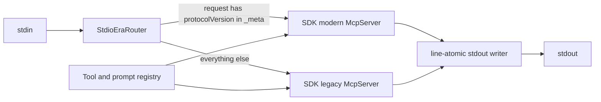

# Design: Dual-Era MCP Support

Status: **proposed**. Nothing described here is implemented. Verified on 2026-11-22 against MCP
2026-07-28 and Java SDK 2.2.0.

## Problem

MCP 2026-07-28 ("modern") replaces the `initialize` handshake with per-request `_meta`.
ArchLens speaks only 2025-11-25 and earlier ("legacy").

| Client | ArchLens today | With this design |
| --- | --- | --- |
| Legacy | works | works, unchanged |
| Dual-era | works, falls back after `server/discover` returns `-32601` | works, modern |
| Modern only | fails, `tools/list` is never answered | works |

Switching to the SDK's modern server is not an option: it rejects `initialize`, and legacy clients
cannot fall forward.

## Goals

- Serve both eras from `java -jar archlens.jar`, with no flag.
- Define each tool once.
- Keep legacy behavior and payloads unchanged.

Non-goals: HTTP, tasks, subscriptions, multi round-trip requests.

## What has to be solved first

### 1. Tool calls race

Both SDK servers run handlers on a thread pool, while `ModelCache` and `GraphStore` are mutable and
unsynchronized. This already happens on 2.3.0: send `index_workspace` and then `list_apps` without
waiting, and `list_apps` answers first with "No workspace indexed yet". A query that overlaps
`store.clear()` can also observe a partial graph.

Proposal: build into a fresh `GraphStore` and publish it with one atomic swap, so a reader always
holds a complete graph. Serialize writers. This fixes torn reads. It does not order pipelined
requests, which is what the explicit handle below is for.

### 2. The workspace is implicit state

The modern spec says state that spans requests MUST be referenced by an explicit identifier passed
on each request. ArchLens tools read "the active workspace" left behind by an earlier
`index_workspace`.

Proposal:

- `index_workspace` returns a `workspaceId` (the cache already derives a key per workspace).
- Every query tool accepts `workspaceId`.
- Modern era: required. Legacy era: optional, defaulting to the active workspace.
- An unknown id is a tool error. Ids are validated against the key format before any file access.

This is the largest part of the work and the only part agents and skills will notice.

## Architecture

- **Router.** The spec selects the era per request: modern `_meta` is served statelessly and
  `initialize` selects legacy. Both may share a process. Each SDK transport accepts its own streams,
  so the router only copies lines and needs no SDK internals.
- **Notifications.** `notifications/cancelled` may lack `_meta`, so it goes to the server that owns
  the request id. The router therefore tracks in-flight ids.
- **Writer.** The legacy transport writes a message and its newline separately. Output must be
  buffered per transport and emitted a whole line at a time.
- **Shutdown.** EOF closes both pipes. The modern transport uses daemon threads, so `Main` must
  wait on its `start()` result and drain in-flight legacy calls.
- **Registry.** `buildToolSpecifications()` becomes an era-neutral list of name, schemas and
  handler, with one adapter per SDK API. The dashboard consumes the same list.

A throwaway spike of the router with both SDK 2.2.0 servers on one stdio pair returned a correct
`DiscoverResult`, a `-32022` error for an unknown version, and a normal legacy `initialize` result.

## Modern-era requirements

| Requirement | Source |
| --- | --- |
| `server/discover` | SDK |
| `resultType`, `serverInfo` in result `_meta` | SDK |
| `UnsupportedProtocolVersionError` | SDK, lists modern versions only |
| `ttlMs` and `cacheScope` on list results | ArchLens chooses: one hour, `public` (static per build) |
| Deterministic `tools/list` | ArchLens, canonicalized schemas |
| Any JSON value as `structuredContent` | ArchLens, see below |
| No logging capability | ArchLens logs to stderr already |

## Structured output and the draft flag

`ARCHLENS_MCP_EXPERIMENTAL_DRAFT` sends top-level arrays, which are valid in 2026-07-28 and invalid
in 2025-11-25, the version it negotiates today.

Proposal: deprecate the flag, then remove it in the next major. Keep the named-object shape in both
eras, so a client gets the same shape whichever era it negotiates.

## Delivery

| PR | Change | Breaking | Size |
| --- | --- | --- | --- |
| A | Atomic graph publication and serialized writers | no | S |
| B | `workspaceId` returned and optionally accepted | no | L |
| C | Era-neutral registry | no | M |
| D | Router, modern adapter, required `workspaceId` for modern requests | no | M |
| E | Deprecate, later remove, the draft flag | at removal | S |

A is worth doing even if the rest is not.

## Testing

- Wire tests for every row of the compatibility table, plus both eras interleaved in one process.
- An unknown version returns `-32022` with `supported`.
- Cancellation reaches the owning era.
- Concurrent index and query never observe a partial graph.
- Both eras list the same tool names; stdout carries only whole JSON-RPC lines.
- Before release, the official conformance suite and one real client per era.

## Risks

- The SDK says its `modern` API may change in minor releases until 3.0. Confine it to one adapter
  and review every SDK bump.
- The modern server generates a random `requestState` key and warns on startup. It is harmless
  without multi round-trip requests.

## Decisions needed

1. Require `workspaceId` in the modern era (recommended, follows the MUST), or keep the implicit
   workspace and document the deviation?
2. Keep named-object output in both eras (recommended), or use top-level arrays for modern clients?
3. Build D now, or after A and B while the SDK's modern API settles (recommended)?

## References

- [Versioning and compatibility](https://modelcontextprotocol.io/specification/2026-07-28/basic/versioning)
- [stdio transport](https://modelcontextprotocol.io/specification/2026-07-28/basic/transports/stdio)
- [Statelessness](https://modelcontextprotocol.io/specification/2026-07-28/basic/index#statelessness)
- [Java SDK modern server](https://java.sdk.modelcontextprotocol.io/latest/server-modern/)
